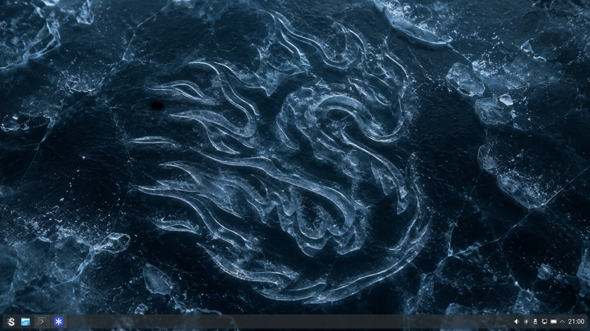

title = "Plasma 6.8 goes Wayland-only, so we forked it"
excerpt = "KDE Plasma 6.8 is going Wayland-only in a few days, so we forked it for you: SonicDE, pure X11, a home for your KDE and Qt 6 native apps."
categories[] = "news"
teaser = "images/sonicde-desktop.png"
;;
KDE Plasma 6.8 is going Wayland-only in a few days, so we forked it for you.

## Meet SonicDE

SonicDE is pure X11, and a home for your KDE and Qt 6 native apps. If you depend on X11, you
can keep a KDE desktop and the applications you already use, without switching to Wayland.

## Where it stands

SonicDE is currently made up of about 140 components, based on Plasma 6.7.5. It will move to
6.8 soon.

## Get it

Find the packages for your distribution on the [Installing SonicDE](https://sonicde.org/installing)
page. If you'd rather build it yourself, follow the
[build guide](https://sonicde.org/docs/getting-started/building) in our documentation.
