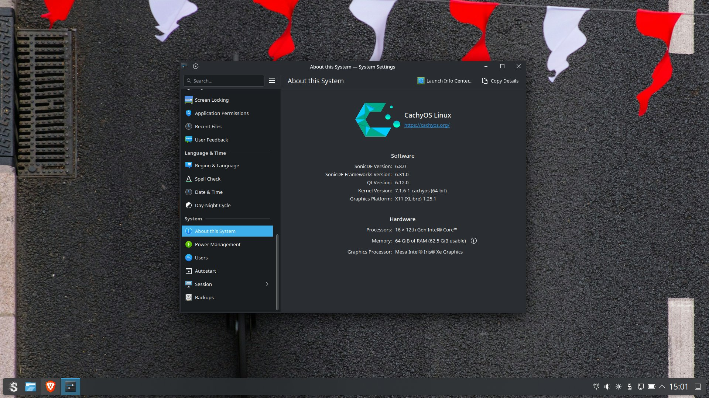

title = "SonicDE 6.8.0 in the Arch Linux stable-testing repository"
excerpt = "SonicDE 6.8.0 is available in the third-party SonicDE repository for Arch Linux. Switch to the stable-testing branch, give it a try, and share your feedback."
categories[] = "release-notes"
teaser = "images/sonicde-6.8.0-arch-stable-testing.png"
;;
SonicDE 6.8.0 is now available in the third-party SonicDE repository for
[Arch Linux](https://archlinux.org), at [sonicde-arch.github.io](https://sonicde-arch.github.io).

## Try it

Please switch to the **stable-testing** branch of the repository, give it a try, and share
your feedback with us! The repository page explains how to set it up.
