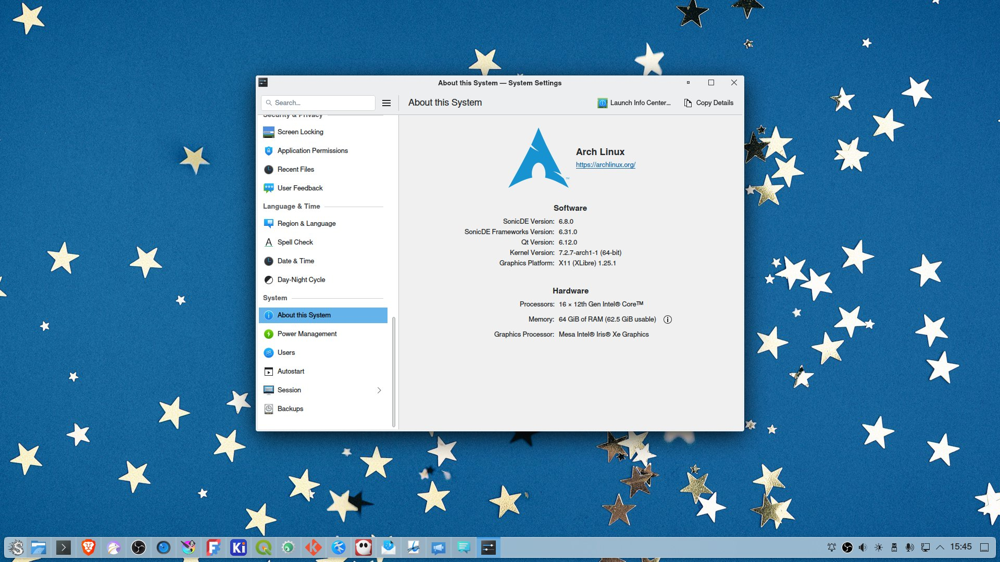

title = "SonicDE 6.8.0 released"
excerpt = "SonicDE 6.8.0 is out: our X11 desktop environment is now built independently of KDE Plasma 6, ready for KDE and Qt applications."
categories[] = "release-notes"
teaser = "images/sonicde-6.8.0-arch.png"
;;
We're happy to announce SonicDE 6.8.0!

Our X11 desktop environment is now built independently of KDE Plasma 6, ready for KDE and Qt
applications.

## Where to get it

Packages are available for [Arch Linux](https://archlinux.org) at
[sonicde-arch.github.io](https://sonicde-arch.github.io).

[Artix Linux](https://artixlinux.org), [Gentoo Linux](https://www.gentoo.org) and
[Void Linux](https://voidlinux.org) are following soon.
