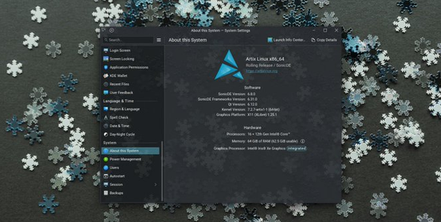

title = "SonicDE 6.8.0 released for Artix Linux"
excerpt = "SonicDE 6.8.0 is out for Artix Linux. Read the README and run the sonic-switch script for an easy transition."
categories[] = "release-notes"
teaser = "images/sonicde-6.8.0-artix.png"
;;
Today we released SonicDE 6.8.0 for [Artix Linux](https://artixlinux.org), available at
[sonicde-artix.github.io](https://sonicde-artix.github.io).

## Switching to SonicDE

Please read the [README](https://sonicde-artix.github.io) first, then run the `sonic-switch` script
for an easy transition.

## What's in this release

| Component | Version |
| :--- | :--- |
| SonicDE | 6.8.0 |
| SonicDE Frameworks | 6.31.0 |

## Get help

Make sure to join our chats for help and praise! ;-)

- [Discord](https://discord.gg/cNZMQ62u5S)
- [Matrix](https://matrix.to/#/#sonicdesktop:matrix.org)
- [IRC: #sonicde on OFTC](https://webchat.oftc.net/?channels=sonicde%2Csonicde-devel%2Csonicde-dist)
- [Telegram](https://t.me/sonic_de)
